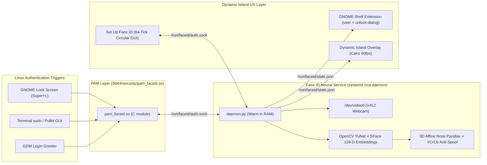

# FaceID for Linux — iPhone Dynamic Island & 3D Anti-Spoof Biometrics

<p align="center">
  
  <br/>
  
  <br/>
  
</p>

<p align="center">
  <b>Bring the authentic iPhone Face ID & Dynamic Island experience to Linux (Fedora / GNOME Wayland).</b><br/>
  Unlock your GNOME Lock Screen (<code>Super+L</code>), authenticate <code>sudo</code> & Polkit prompts, and log in hands-free with a 60fps spring-animated Dynamic Island HUD and 3D Presentation Attack Detection (PAD) using any standard webcam.
</p>

---

## ✨ Features

- **🏝️ 60fps Dynamic Island HUD**: A spring-animated obsidian pill anchored directly beneath your top-center webcam (`dynamic_island_hud.py` + GNOME Shell 51 Extension) with the Apple Face ID vector glyph, live circular mini-camera ring, unlocking emerald padlock morph, and iOS horizontal shake on mismatch.
- **🛡️ 3D Presentation Attack Detection (Anti-Spoofing)**: Blocks printed photos and phone-screen replays using an exact $2\times 2$ affine nose-protrusion parallax invariant ($\Delta_{\text{3D}} = \|[\vec{u}, \vec{v}]^{-1}(N - E_{\text{mid}})\|_2$), YCrCb skin-chrominance validation, and specular screen-glare rejection.
- **⚡ Sub-Half-Second Warm Daemon (`faceid-daemon.service`)**: Keeps OpenCV **YuNet** (5-landmark CNN face detector) and **SFace** (128-D neural arcface recognizer) pre-loaded in RAM (~45 MB) for instant recognition without cold-start Python overhead.
- **🔒 Native C PAM Module (`pam_faceid.so`) & SELinux Policy**: Zero-lockout fail-open design (`PAM_IGNORE`), automatic SSH remote session bypass, and full Fedora `SELinux Enforcing` support (`faceid_selinux.te`) for `gdm-session-worker`, `sudo`, and Polkit.
- **🟢 Circular 64-Tick iOS Setup Wizard (`setup_app.py`)**: Enroll your face across 24 multi-angle poses inside a circular live camera viewport surrounded by 64 glowing emerald tick segments.

<p align="center">
  
</p>

---

## 🏗️ Architecture



---

## 🧮 How 3D Anti-Spoofing Works on a Standard Webcam

A naive 2D face recognizer can be fooled by holding up a photo on a smartphone and moving your hand slightly. **FaceID for Linux** blocks 2D photo and screen attacks using three physical and geometric invariants:

1. **Exact $2\times 2$ Affine Nose-Protrusion Parallax ($\Delta_{\text{3D}}$)**:
   - Let $E_R, E_L$ be the right and left eye centers, $M_R, M_L$ be the mouth corners, $E_{\text{mid}} = \frac{1}{2}(E_R + E_L)$, and $M_{\text{mid}} = \frac{1}{2}(M_R + M_L)$.
   - Using the basis vectors $\vec{u} = E_L - E_R$ and $\vec{v} = M_{\text{mid}} - E_{\text{mid}}$, we solve for the nose tip's intrinsic affine coordinates $(\alpha, \beta)$:
     $$[\alpha, \beta]^T = [\vec{u}, \vec{v}]^{-1}(N - E_{\text{mid}})$$
   - **Why a 2D photo fails**: On a flat phone screen or printed photo, all 5 landmarks are coplanar ($z = 0$). Any 3D translation, zoom, rotation, or out-of-plane tilt multiplies $\vec{u}$, $\vec{v}$, and $(N - E_{\text{mid}})$ by the same $2\times 2$ matrix $T$, so $T^{-1}T = I$ cancels out and $(\alpha, \beta)$ remains invariant ($\Delta_{\text{3D}} < 0.015$).
   - **Why a real 3D face passes**: A real human nose protrudes ~25–35 mm out of the eye–mouth plane ($z > 0$). A subtle $8^\circ\text{–}12^\circ$ head turn or nod produces non-coplanar 3D parallax ($\Delta_{\text{3D}} \ge 0.052$) alongside a 3D viewpoint shift in the 128-D SFace embedding.
2. **YCrCb Skin Chrominance & Specular Screen Glare**:
   - Rejects frames exhibiting OLED/LCD blue-backlight shifts (`skin_ratio < 0.22` in $130 \le C_r \le 180, 75 \le C_b \le 135$) or clipped glass reflections (`glare_ratio > 0.22`).

---

## 🚀 Quick Start (Fedora 40–45 / GNOME Wayland)

### 1. Clone & Run the Automated Installer

```bash
git clone https://github.com/princetonacelopez/FaceID.git
cd FaceID
sudo ./install-faceid.sh
```

The installer automatically:
- Installs `python3-opencv`, `pam-devel`, `checkpolicy`, and `policycoreutils-python-utils`
- Downloads the official OpenCV Zoo **YuNet** (`228 KB`) and **SFace** (`36.9 MB`) ONNX models to `/var/lib/faceid/models/`
- Compiles and installs `/lib64/security/pam_faceid.so`
- Compiles and loads the `faceid_selinux.pp` SELinux module
- Starts `faceid-daemon.service` and the `faceid-hud.service` Dynamic Island overlay
- Registers `auth sufficient pam_faceid.so` in PAM with automatic backups

### 2. Enroll Your Face

Launch the **"Face ID & Passcode"** circular scanner app:

```bash
faceidctl enroll
```

Click **"Set Up Face ID"** and slowly move your head in a circle until all 64 radial ticks turn emerald green.

---

## 🛠️ CLI Reference (`faceidctl`)

```bash
# View daemon health, loaded models, enrolled angle count, and PAM status
faceidctl status

# Trigger a live webcam Face ID check and watch the Dynamic Island unlock
faceidctl test

# Preview the Dynamic Island animation (success or failure state)
faceidctl demo
faceidctl demo fail

# Launch the GTK4 "Set Up Face ID" GUI (or enroll via terminal with --cli)
faceidctl enroll
faceidctl enroll --cli

# Instant PAM killswitch / re-enable
sudo faceidctl disable
sudo faceidctl enable
```

---

## 🔐 Security & Zero-Lockout Design

- **Fail-Open to Password (`PAM_IGNORE`)**: If your camera is unplugged, the room is dark, the daemon is stopped, or no 3D match occurs within the 4.5-second window, `pam_faceid.so` returns `PAM_IGNORE` and hands off seamlessly to standard `pam_unix.so` password authentication.
- **Emergency Killswitch**: Creating `/etc/faceid/disabled` or running `sudo faceidctl disable` bypasses `pam_faceid.so` immediately.
- **Remote SSH Bypass**: `pam_faceid.c` inspects `PAM_RHOST` and automatically skips webcam authentication for remote SSH sessions.

---

## 📄 License

Released under the [MIT License](LICENSE).  
Created by **Princeton Ace Lopez** ([@princetonacelopez](https://github.com/princetonacelopez)).
